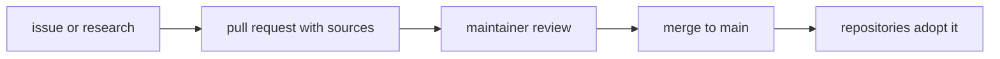

# Engineering Practices

[](https://github.com/Vercroft/engineering-practices/actions/workflows/ci.yml)

The rules we follow in every repository, written down so others can adopt them: git and pull requests, security,
supply chain, testing, documentation and licensing, plus a page per language or tool. Maintained by the Vercroft
maintainers.

- **Maintainer:** a person with write access who approves and merges changes.
- **Adopt:** make a repository follow these rules, by linking its `CONTRIBUTING.md` here and copying the configuration it
  needs.
- **Reserved:** a rule number that is not used here; the numbers never change, so citations keep resolving.

## How a change reaches the rules



## Pages

| Page | Covers |
|---|---|
| [STANDARD.md](STANDARD.md) | The rules, numbered; a number never changes |
| [docs/python.md](docs/python.md) | Python: layout, typing, errors, dependencies, one ruff, mypy, pytest and uv block |
| [docs/frontend.md](docs/frontend.md) | TypeScript and JavaScript: Biome by default, strict `tsc`, pnpm settings |
| [docs/rust.md](docs/rust.md) | Rust: workspace, toolchain, lints, cargo-deny, nextest |
| [docs/suppressions.md](docs/suppressions.md) | When a lint suppression is allowed, and how it is listed and checked |
| [docs/dependabot.md](docs/dependabot.md) | Monthly grouped Dependabot, the 7-day dependency age rule, the template |
| [docs/documentation.md](docs/documentation.md) | How a repository documents itself: templates, sources, reasons |
| [CHANGELOG.md](CHANGELOG.md) | What changed in each release |
| [docs/decisions/](docs/decisions/) | One dated record per decision that moved into this repository |
| [.github/](.github/) | The workflows that check this repository: licences, leaks, workflow audit, links, CodeQL, Scorecard |

## Adopting it

1. Link your repository's `CONTRIBUTING.md` to the rules it follows and add only what is specific to it.
2. Copy the configuration blocks from the page for your language, and the Dependabot template.

## Quick start

```sh
VENV="${TMPDIR:-/tmp}/ep-venv"
python3 -m venv "$VENV"
"$VENV/bin/pip" install --require-hashes -r .github/requirements/reuse.txt
"$VENV/bin/reuse" lint   # needs the system package libmagic1t64
```

More commands: [CONTRIBUTING.md](CONTRIBUTING.md).

## Licence

Text is CC BY 4.0 ([LICENSE](LICENSE)); code samples and configuration blocks in the docs, and this repository's own
workflows and configuration files, are MIT ([LICENSES/MIT.txt](LICENSES/MIT.txt)). Each file's licence is declared in
[REUSE.toml](REUSE.toml). To attribute: "Engineering Practices, by the Vercroft maintainers, CC BY 4.0", with a link to
this repository and a note of any changes. Report a security problem as [SECURITY.md](SECURITY.md) says.
